# 内弹道多目标优化设计

**Interior Ballistics Multi-Objective Optimization** — MATLAB 实现

> 本仓库是南京理工大学学士学位论文《**弹道设计软件开发及实践**》的配套代码，
> 作者：**彰彬**（学号 921108320144），能源与动力工程学院 · 武器发射工程专业，
> 指导教师：**张小兵 教授**、**耿宝魁 研究员（校外）**，2025 年 5 月。

本仓库对论文的工程实践部分做了整理：以最终可用版本为核心（`src/`），
把建模过程中产生的原型、参考样本与测试代码完整归档（`legacy/`），
并补充了模型与算法的说明文档（`docs/`）。

---

## 目录

- [项目简介](#项目简介)
- [主要结果](#主要结果)
- [仓库结构](#仓库结构)
- [环境要求](#环境要求)
- [快速开始](#快速开始)
- [核心模块](#核心模块)
- [数学模型与算法](#数学模型与算法)
- [案例与结果](#案例与结果)
- [已知问题与后续工作](#已知问题与后续工作)
- [引用](#引用)
- [许可](#许可)

---

## 项目简介

传统内弹道设计中，**初速与膛压相互矛盾**：提高初速需要增加装药量，但会推高膛压峰值。
经典经验设计法只能"先固定装药利用系数 η，再反解火药弧厚 e1"，无法在多参数空间中
协调初速、膛压与装药经济性。

本项目围绕这一矛盾，构建了一套**通用内弹道设计方法**：

1. **参数动态封装** — `ballistic_design(e1, eta)` 把火炮构造参数、火药性质与
   装填条件集中计算，解耦"火药形状 / 装药条件 / 弹道模型"，为优化算法提供标准化输入；
2. **常规设计：二分法反解火药弧厚** — 由"火药弧厚—最大膛压"的近似单调关系，
   用二分查找使计算膛压收敛到设计膛压，容差 **±1 kPa**；
3. **多目标优化：实数编码遗传算法** — 以装药利用系数 η 与火药弧厚 e1 为决策变量，
   用 `gamultiobj` 生成初速极大化 / 膛压极小化的 **Pareto 非劣解集**，
   并以**动态惩罚函数**处理膛压约束；
4. **工程验证** — 以 **57 mm 高射炮**与 **152 mm 榴弹炮**两组不同口径、不同战术
   要求的火炮为案例，对比常规设计与优化设计的效果。

---

## 主要结果

在保证炮口初速波动 < 0.1% 的前提下，优化方案显著降低了膛压峰值：

| 案例 | 最大膛压（常规设计） | 最大膛压（优化设计） | 降幅 |
| :--- | ---: | ---: | ---: |
| 57 mm 高射炮 | 312.9 MPa | 306.3 MPa | **−2.12 %** |
| 152 mm 榴弹炮 | 235.8 MPa | 230.8 MPa | **−2.12 %** |

两组案例获得几乎一致的膛压降幅，说明该方法对**不同口径、不同装填密度与燃速特性**
的火炮均具有适应性。详细数据与曲线见 [案例与结果](#案例与结果)。

---

## 仓库结构

```
interior-ballistics-optimization/
├── README.md                    本文件（中文说明）
├── README_EN.md                 English documentation
├── LICENSE                      MIT 许可证
├── CITATION.cff                 引用信息
├── src/                         ★ 最终版本代码（论文第 3、4 章所用）
│   ├── main.m                       入口脚本：常规设计 + 多目标优化 + 绘图对比
│   ├── ballistic_design.m           参数封装模块
│   ├── solve_ballistic.m            内弹道方程组求解器（ode45）
│   ├── ballistic_ode.m              内弹道微分方程组
│   ├── binary_search_e1.m           二分查找反解火药弧厚
│   ├── multi_objective_optimization.m  多目标遗传算法 + 动态惩罚函数
│   └── analyze_results.m            结果后处理与四联图绘制
├── docs/
│   ├── theory.md                模型与算法说明（方程组、参数、算法流程）
│   ├── results.md               案例参数、结果数据与曲线
│   └── figures/                 论文插图（由论文文档导出为 PNG）
└── legacy/                      历史版本归档（按演进顺序）
    ├── README.md                各历史版本的说明与差异
    ├── 00-prototype-initial/    最初原型（initialize_parameters 结构）
    ├── 01-reference-sample/     课程设计参考样本
    ├── 02-early-ode-model/      早期无量纲化 ODE 模型（59-130 火炮）
    ├── 03-test-version/         测试版本（绘图与并行设置与最终版不同）
    └── 04-57mm-parameter-variant/  57 mm 高射炮参数版本
```

各历史版本的差异说明、量纲注意事项与未归档文件说明见
**[legacy/README.md](legacy/README.md)**。

---

## 环境要求

| 项目 | 要求 |
| :--- | :--- |
| 平台 | MATLAB R2018b 或更新版本（本地验证基于 R2022b+，任意版本均可运行） |
| 必需工具箱 | **Global Optimization Toolbox**（`gamultiobj`、`optimoptions`） |
| 可选工具箱 | **Parallel Computing Toolbox** — 仅当 `multi_objective_optimization.m` 中保持 `UseParallel = true` 时需要 |

> 若未安装 Parallel Computing Toolbox，请把 `multi_objective_optimization.m`
> 中的 `'UseParallel', true` 改为 `'UseParallel', false`（`legacy/03-test-version/`
> 中即为该配置）。所需改动仅此一处。

---

## 快速开始

1. 用 MATLAB 打开 `src/` 目录（或 `cd` 到该目录）；
2. 运行入口脚本：

```matlab
>> main
```

`main.m` 会依次执行：

1. `binary_search_e1()` — 固定 η = 1500，二分反解满足设计膛压的火药弧厚 e1；
2. `multi_objective_optimization()` — 对 (η, e1) 做双目标优化，输出 Pareto 解集并打印最优解；
3. `analyze_results(...)` — 把常规设计（蓝）与优化设计（红）的压力—行程、
   速度—行程曲线叠加在同一张四联图上对比，并打印行程长、炮口初速与最大膛压。

控制台输出示例：

```
完成 e1	: 0.xxxx
最优结果: eta = 15xx.xxxx, e1 = x.xxxxe-04
Best eta: 15xx.xxxx, Best e1: x.xxxxe-04
运行时间: xx.xx秒
[b] 行程长: x.xxxx dm
[b] 炮口初速: xxx.xxxx m/s
[b] 最大膛压: 235.xxxx MPa
[r] 行程长: ...
[r] 炮口初速: ...
[r] 最大膛压: 230.xxxx MPa
```

---

## 核心模块

### `ballistic_design(e1, eta)` — 参数封装模块

* **输入**：`e1` 火药弧厚（m）、`eta` 装药利用系数（kJ/kg）
* **输出**：结构体 `params`，汇总弹丸特性、压力约束、火药燃烧参数、
  几何特征量与动态计算量
* **要点**：
  * 由装药利用系数反算装药质量 `omega = m*v_g^2/(2e3*eta)`；
  * 由选定火药（7 孔）几何推导形状特征量 `chi / lambda / mu` 及
    碎粒阶段特征量 `chi_S / lambda_S`、燃烧分裂点 `Z_b`；
  * 装填密度为 **输入常量**，药室容积 `V0 = omega/delta` 随装药量联动。

### `solve_ballistic(params)` — 方程组求解

状态量 `y = [psi, Z, l, v, p]`（燃去百分比、相对燃烧厚度、行程、速度、膛压），
初值由挤进压力 `p0` 对应的 `psi0`、`Z0` 给出；以 `ode45` 在 `t ∈ [0, 0.1] s`
上积分，`MaxStep = 1e-4`、`RelTol = 1e-6`。

### `binary_search_e1()` — 常规设计

搜索区间 `e1 ∈ [5e-5, 5e-2] m`，目标 `p_max → p_m`，容差 `1e3 Pa`（±1 kPa），
最大 100 次迭代；η 固定为 1500。是论文"常规设计"路线的实现。

### `multi_objective_optimization()` — 多目标优化

| 设置 | 取值 |
| :--- | :--- |
| 决策变量 | `eta ∈ [1400, 1600]`，`e1 ∈ [5e-5, 5e-3]` m |
| 目标 1 | 最大化炮口初速 `v_muzzle`（实现为最小化 `-v_muzzle/1000`） |
| 目标 2 | 最小化最大膛压 `p_max`（实现为最小化 `p_max/1e6`） |
| 约束 | `p_max` 落在 `p_m` 的 ±2 % 带内，越界按 MPa 计违规量并施加动态惩罚 |
| 算法 | `gamultiobj`，PopulationSize 100，MaxGenerations 100，CrossoverFraction 0.8，ParetoFraction 0.5 |

动态惩罚系数 `penalty_coeff = 1e3*(1 + 0.5*(violation > 0))`：违规越大惩罚越重，
使算法早期允许轻微越界以扩大探索范围、后期收敛到可行域。

---

## 数学模型与算法

模型假设、完整方程组、参数含义与算法流程见 **[docs/theory.md](docs/theory.md)**。
核心方程组（多孔火药经典内弹道模型）为：

$$
\begin{aligned}
\frac{\mathrm{d}Z}{\mathrm{d}t} &= \frac{u_1}{e_1} p^{n_1}, & Z < Z_b \\[2pt]
\frac{\mathrm{d}\psi}{\mathrm{d}t} &=
\begin{cases}
(\chi + 2\lambda\chi Z + 3\mu\chi Z^2)\,\dfrac{\mathrm{d}Z}{\mathrm{d}t}, & Z < 1 \\[6pt]
\dfrac{\chi_S}{Z_b}\left(1 + \dfrac{2\lambda_S}{Z_b}Z\right)\dfrac{\mathrm{d}Z}{\mathrm{d}t}, & 1 \le Z < Z_b
\end{cases} \\[2pt]
\frac{\mathrm{d}l}{\mathrm{d}t} &= v \\[2pt]
\frac{\mathrm{d}v}{\mathrm{d}t} &= \frac{S\,p}{\varphi m} \\[2pt]
\frac{\mathrm{d}p}{\mathrm{d}t} &= \frac{1}{S\,(l + l_\psi)}
\left(f\omega\frac{\mathrm{d}\psi}{\mathrm{d}t}
- \theta\varphi m v\frac{\mathrm{d}v}{\mathrm{d}t}
- S\,p\,v\right)
\end{aligned}
$$

其中 $\theta = k - 1$，$l_\psi$ 为药室自由容积缩径长。

---

## 案例与结果

两组验证案例的全部参数、数据表与曲线图见 **[docs/results.md](docs/results.md)**。

### 57 mm 高射炮

| 传统设计 压力—行程 | 优化设计 压力—行程 |
| :---: | :---: |
| 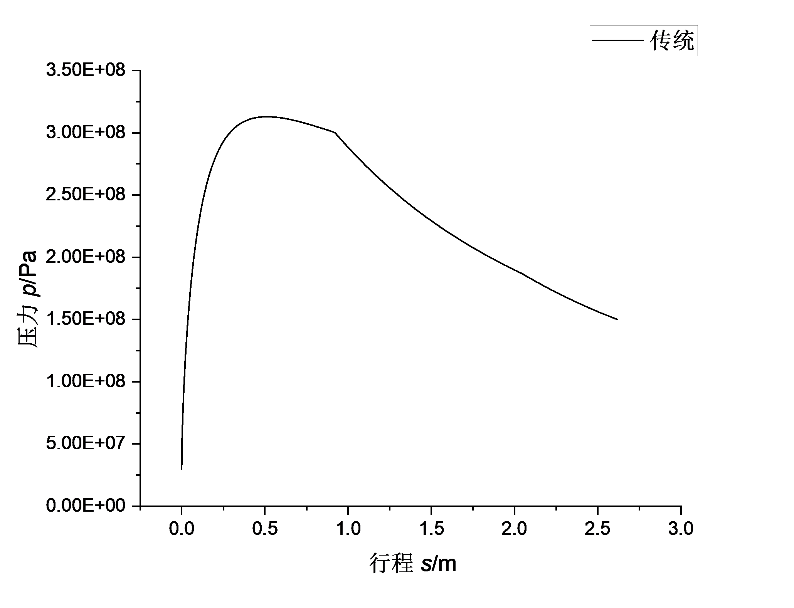 | 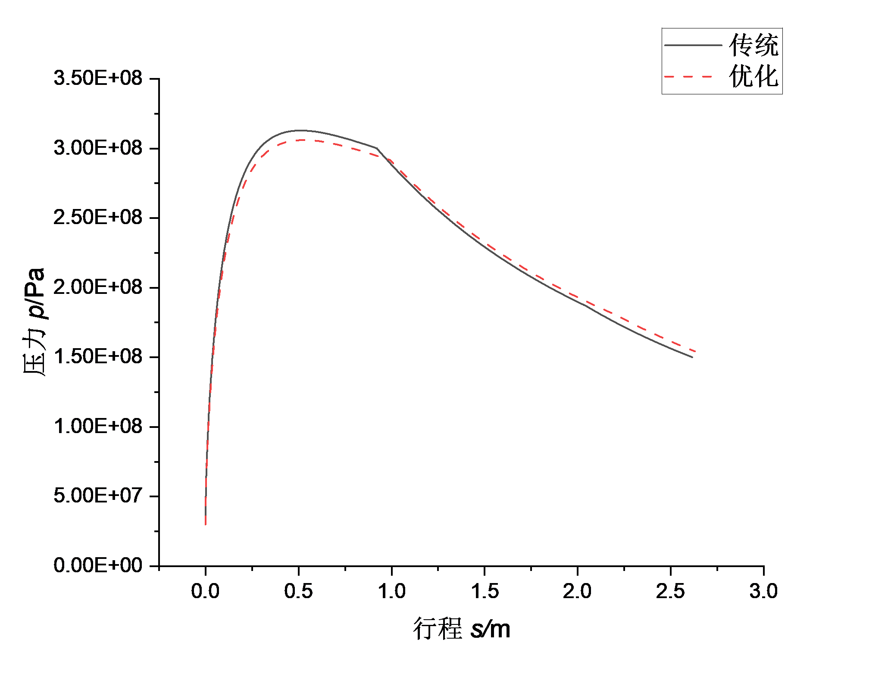 |

Pareto 前沿（横轴为取负后的初速，纵轴为膛压峰值）：

| Pareto 前沿 | Pareto 最优解集 |
| :---: | :---: |
| 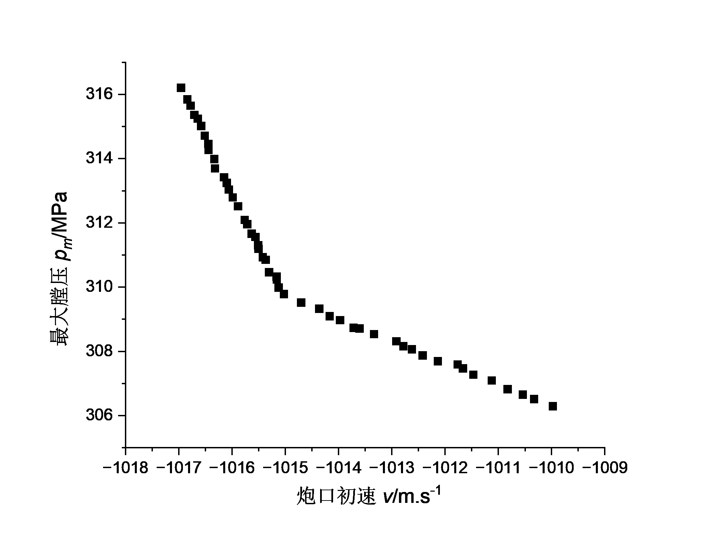 | 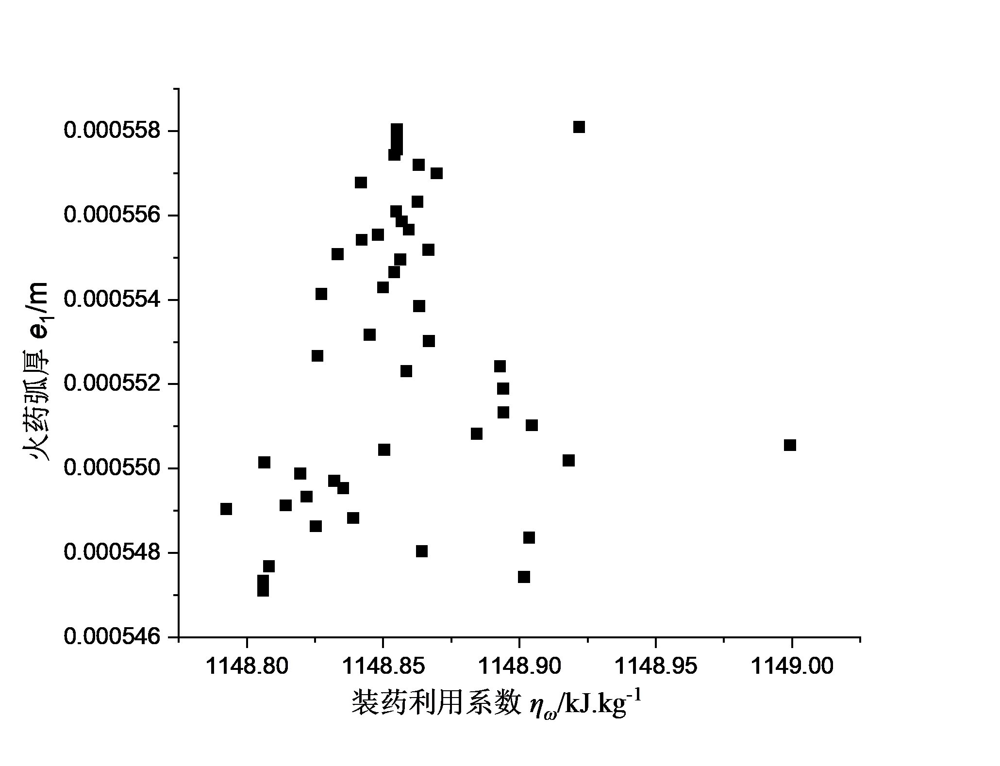 |

### 152 mm 榴弹炮

| 传统设计 压力—行程 | 优化设计 压力—行程 |
| :---: | :---: |
| 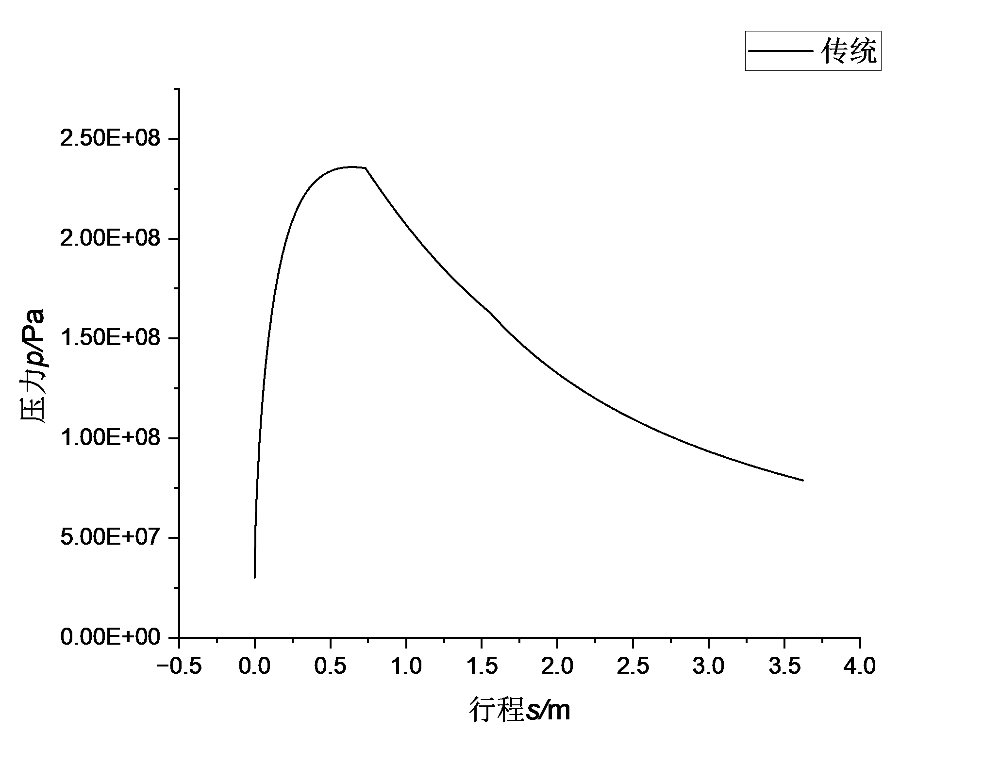 | 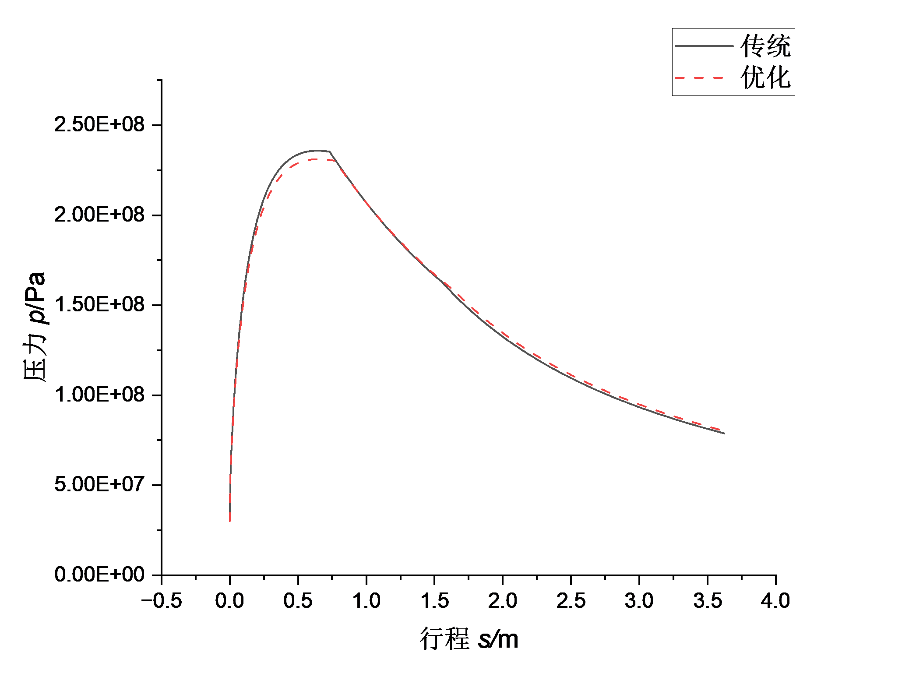 |

| Pareto 前沿 | Pareto 最优解集 |
| :---: | :---: |
| 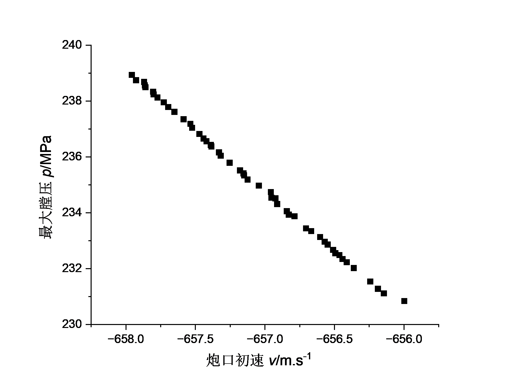 | 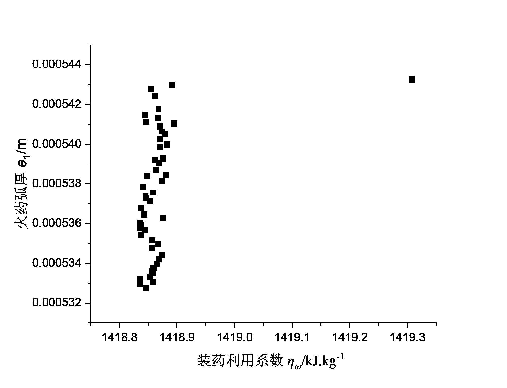 |

方法流程图：

| 参数封装模块 | 二分查找 | 多目标优化 |
| :---: | :---: | :---: |
| 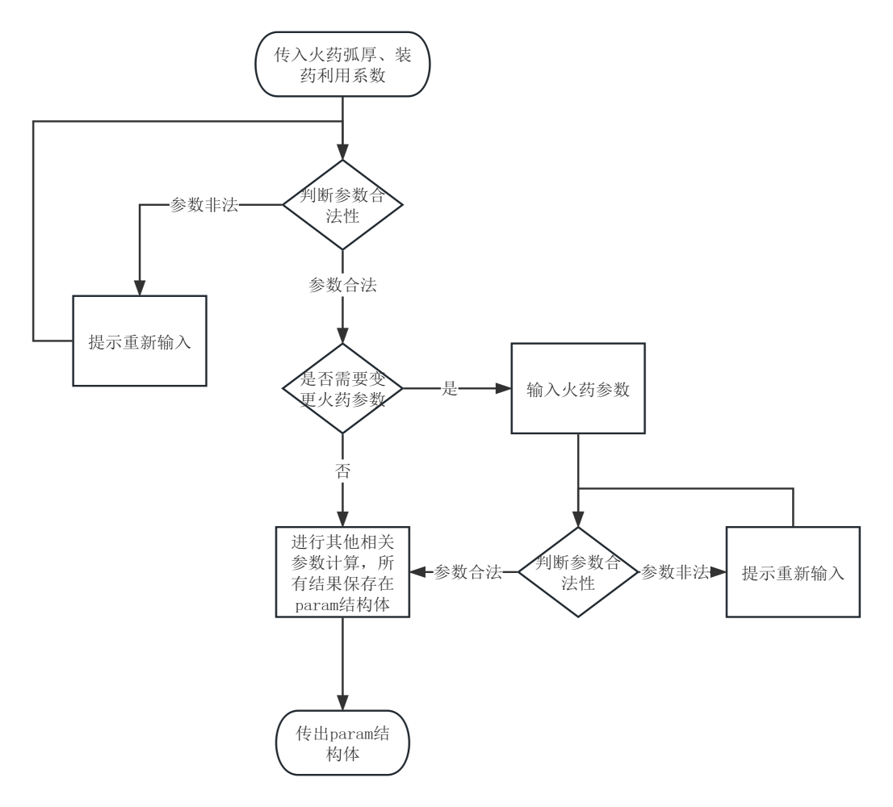 | 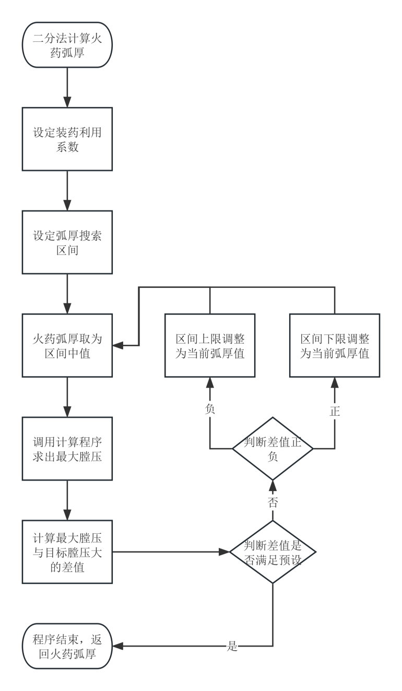 | 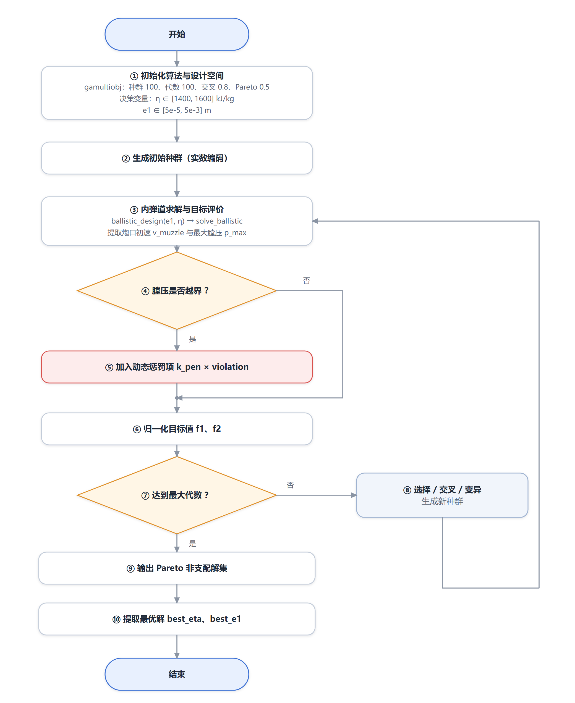 |

---

## 已知问题与后续工作

整理过程中发现并处理的问题，以及可继续改进的方向：

**已在本次整理中处理**

1. **补回缺失文件** — 原"最终"版本目录缺少 `analyze_results.m`，而 `main.m` 会调用它，
   直接运行会报 `未定义函数或变量 'analyze_results'`。已从测试版本中取回该文件放入 `src/`。
2. **停用 MATLAB 自动化服务** — 原 `main.m` 首行为 `enableservice('AutomationServer',true)`，
   用于外部程序（GUI）驱动 MATLAB，普通命令行运行不需要，且会开放 COM 自动化接口。
   已注释并注明原因，不改变任何计算结果。

**建议后续核对**

3. **`UseParallel` 依赖** — `src/multi_objective_optimization.m` 采用 `UseParallel = true`，
   需要 Parallel Computing Toolbox；无该工具箱时改为 `false` 即可（见
   `legacy/03-test-version/`）。
4. **`l_psi` 的取值方式** — 当前 `ballistic_ode.m` 在每个积分步都用**初始** `psi0`
   计算 `l_psi`，即整个积分过程视为常数；经典公式中 `l_psi` 随 `psi` 变化。
   建议对比两种处理方式对压力曲线的影响，必要时改为随状态量更新。
5. **历史版本中的单位问题** — `legacy/04-57mm-parameter-variant/ballistic_design.m`
   中 `params.c = 14.5/2`（= 7.25，单位 m），与最终版 `14.5e-3/2`（= 7.25e-3 m）
   不一致，会显著改变 `beta = e1/c` 与形状特征量。该文件按原样归档，未作修改，
   使用时请先核对该量纲。
6. **可扩展方向**（与论文展望一致）：图形界面/规范化输入、多孔与分级装药建模、
   深度强化学习等混合智能优化、内弹道—身管热力耦合的多学科验证。

---

## 引用

若本项目对你的研究有帮助，请引用配套学位论文：

```bibtex
@thesis{zhang2025ballistic,
  title       = {弹道设计软件开发及实践},
  author      = {彰彬},
  year        = {2025},
  month       = {5},
  institution = {南京理工大学},
  type        = {学士学位论文},
  note        = {指导教师：张小兵 教授、耿宝魁 研究员（校外）}
}
```

机器可读的引用信息见 [CITATION.cff](CITATION.cff)。

---

## 许可

本项目采用 [MIT License](LICENSE) 发布。

> **说明**：代码与文档均来自作者的本科毕业设计工作，仅供学习与研究使用。
> 仓库中不包含学位论文正文；论文中的参考文献、火药手册数据等第三方资料的
> 著作权归原作者/出版方所有。
