# 案例与结果

本文档汇总学位论文第四章的两组验证案例：**57 mm 高射炮**与 **152 mm 榴弹炮**。
参数与数据取自论文表 4.1–4.14，曲线图取自论文图 4.1–4.20。

- [1. 案例一：57 mm 高射炮](#1-案例一57-mm-高射炮)
- [2. 案例二：152 mm 榴弹炮](#2-案例二152-mm-榴弹炮)
- [3. 代码中的实际参数取值](#3-代码中的实际参数取值)
- [4. 数据一致性提示](#4-数据一致性提示)

---

## 1. 案例一：57 mm 高射炮

### 1.1 初始战术指标（论文表 4.1）

| 参数 | 符号 | 值 |
| :--- | :---: | ---: |
| 口径 | $d$ | 57 mm |
| 弹丸质量 | $m$ | 2.8 kg |
| 设计初速 | $v_g$ | 1000 m/s |
| 最大膛压设计值 | $p_{mT}$ | 303 MPa |
| 药室扩大系数 | $\chi_k$ | 1.9 |
| 装药利用系数 | $\eta_\omega$ | 1176 kJ/kg |
| 装填密度 | $\Delta$ | 0.79 kg/dm³ |

选定的弹丸相对行程长：$\lambda_g = 6.4$（论文在 4.0–8.0 区间内取值）。

### 1.2 导出参数（论文表 4.2）

| 参数 | 值 |
| :--- | ---: |
| $\lambda_1$ | 0.4679 |
| $\lambda_2$ | 0.3119 |
| 次要功计算系数 $\varphi$ | 1.163 |
| 弹道设计压力 $p_m$ | 313 MPa |
| $\Lambda_g$ | 6.4 |

### 1.3 火药初始参数（论文表 4.3）

| 参数 | 值 | 参数 | 值 |
| :--- | ---: | :--- | ---: |
| 火药力 $f$ | 950 kJ/kg | 比热比 $k$ | 1.2 |
| 余容 $\alpha$ | 1.0 dm³/kg | 火药密度 $\rho_p$ | 1.6 kg/dm³ |
| 燃速系数 $u_1$ | 0.18 cm/(s·MPa$^n$) | 燃速指数 $n$ | 0.80 |
| 内孔直径 $d_0$ | 0.4 mm | 药粒长度 $2c$ | 14.5 mm |

挤进压力按线膛炮取值（论文按同类线膛火炮选取）。

### 1.4 常规设计结果（论文表 4.7）

| 参数 | 值 |
| :--- | ---: |
| 装药利用系数 $\eta_\omega$ | 1176 kJ/kg |
| 火药弧厚 $e_1$ | 0.5512 mm |
| 行程长 $l_g$ | 26.1480 dm |
| 炮口压力 $p_g$ | 150.1402 MPa |
| 炮口初速 $v_g$ | 1008.9815 m/s |
| 最大膛压 $p_m$ | 312.9190 MPa |

| 压力—行程 | 速度—行程 |
| :---: | :---: |
|  | 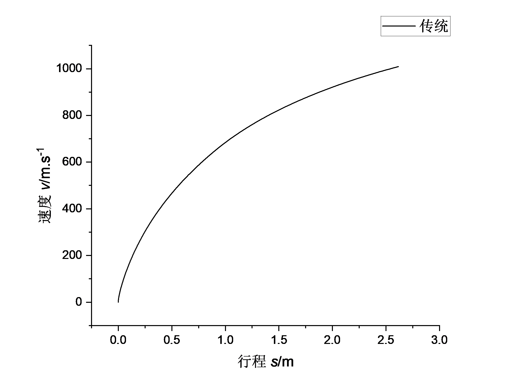 |

| 压力—时间 | 速度—时间 |
| :---: | :---: |
| 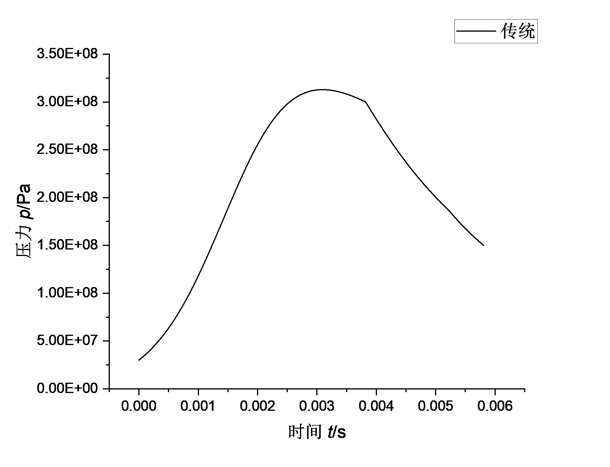 | 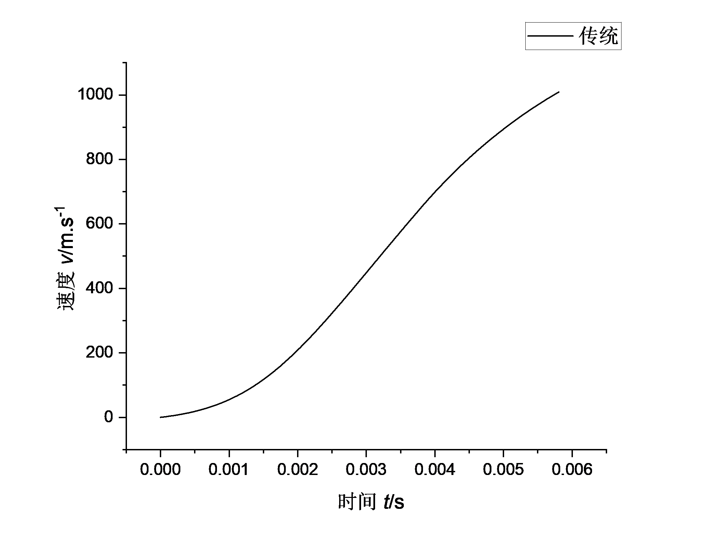 |

### 1.5 优化解与优化结果（论文表 4.8、4.9）

| 优化解参数 | 值 |
| :--- | ---: |
| 装药利用系数 $\eta_\omega$ | 1148.8894 kJ/kg |
| 火药弧厚 $e_1$ | 0.5650 mm |

| 计算结果 | 值 |
| :--- | ---: |
| 行程长 $l_g$ | 26.5152 dm |
| 炮口压力 $p_g$ | 154.2922 MPa |
| 炮口初速 $v_g$ | 1009.9761 m/s |
| 最大膛压 $p_m$ | 306.2903 MPa |

| Pareto 前沿 | Pareto 最优解集 |
| :---: | :---: |
|  |  |

| 压力—行程 | 速度—行程 |
| :---: | :---: |
|  | 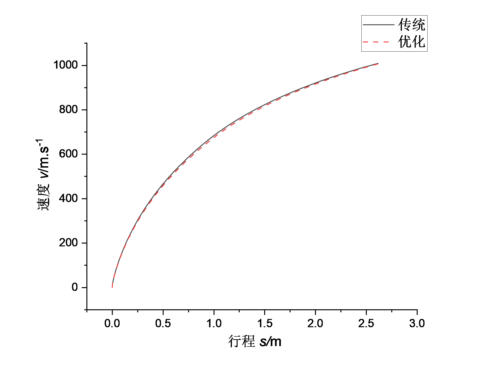 |

| 压力—时间 | 速度—时间 |
| :---: | :---: |
| 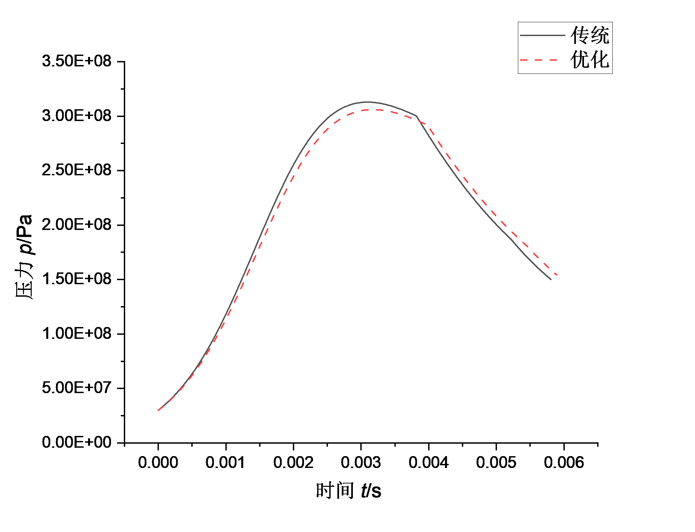 | 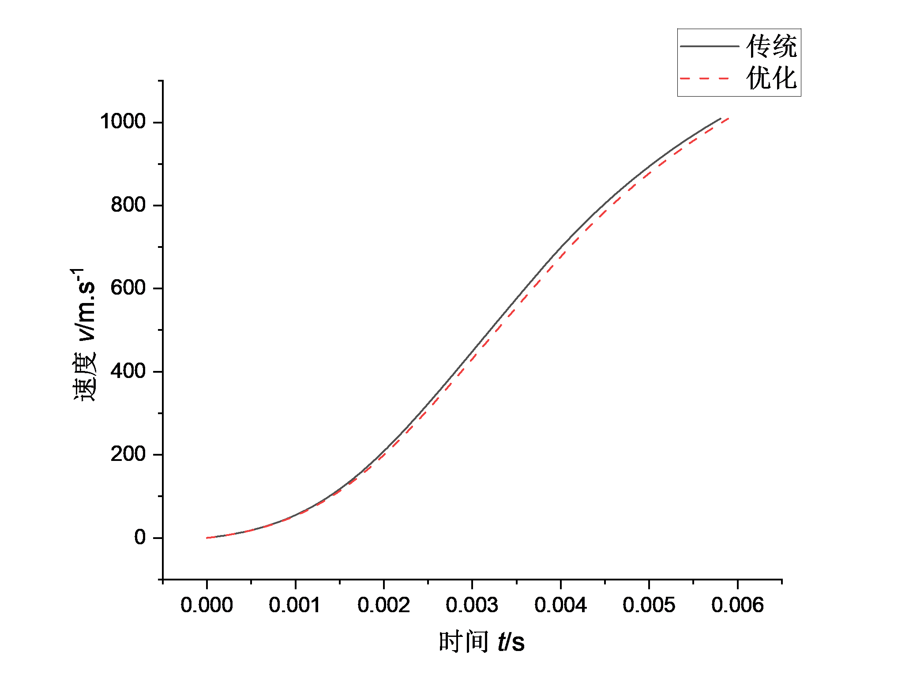 |

### 1.6 优化前后对比（论文表 4.10）

| 指标 | 传统设计 | 优化设计 | 变化范围 |
| :--- | ---: | ---: | ---: |
| 装药利用系数 $\eta_\omega$ | 1176 kJ/kg | 1148.8894 kJ/kg | −3.54 % |
| 火药弧厚 $e_1$ | 0.5512 mm | 0.5650 mm | +2.50 % |
| 行程长 $l_g$ | 26.1480 dm | 26.5152 dm | +1.40 % |
| 炮口压力 $p_g$ | 150.1402 MPa | 154.2922 MPa | +2.76 % |
| 炮口初速 $v_g$ | 1008.9815 m/s | 1009.9761 m/s | +0.09 % |
| **最大膛压 $p_m$** | **312.9190 MPa** | **306.2903 MPa** | **−2.12 %** |

---

## 2. 案例二：152 mm 榴弹炮

### 2.1 初始战术指标（论文表 4.4）

| 参数 | 符号 | 值 |
| :--- | :---: | ---: |
| 口径 | $d$ | 152 mm |
| 弹丸质量 | $m$ | 44.2 kg |
| 设计初速 | $v_g$ | 650 m/s |
| 最大膛压设计值 | $p_{mT}$ | 220 MPa |
| 药室扩大系数 | $\chi_k$ | 1.19 |
| 装药利用系数 | $\eta_\omega$ | 1500 kJ/kg |
| 装填密度 | $\Delta$ | 0.55 kg/dm³ |

选定的弹丸相对行程长：$\lambda_g = 7.0$。

### 2.2 导出参数（论文表 4.5）

| 参数 | 值 |
| :--- | ---: |
| $\lambda_1$ | 0.4900 |
| $\lambda_2$ | 0.3267 |
| 次要功计算系数 $\varphi$ | 1.076 |
| 弹道设计压力 $p_m$ | 236 MPa |
| $\Lambda_g$ | 7.0 |

### 2.3 火药初始参数（论文表 4.6）

| 参数 | 值 | 参数 | 值 |
| :--- | ---: | :--- | ---: |
| 火药力 $f$ | 931 kJ/kg | 比热比 $k$ | 1.2 |
| 余容 $\alpha$ | 1.0 dm³/kg | 火药密度 $\rho_p$ | 1.6 kg/dm³ |
| 燃速系数 $u_1$ | 0.45 cm/(s·MPa$^n$) | 燃速指数 $n$ | 0.890 |
| 内孔直径 $d_0$ | 0.4 mm | 药粒长度 $2c$ | 14.5 mm |

### 2.4 常规设计结果（论文表 4.11）

| 参数 | 值 |
| :--- | ---: |
| 装药利用系数 $\eta_\omega$ | 1500 kJ/kg |
| 火药弧厚 $e_1$ | 0.5208 mm |
| 行程长 $l_g$ | 36.2278 dm |
| 炮口压力 $p_g$ | 78.8305 MPa |
| 炮口初速 $v_g$ | 656.0344 m/s |
| 最大膛压 $p_m$ | 235.8341 MPa |

| 压力—行程 | 速度—行程 |
| :---: | :---: |
|  | 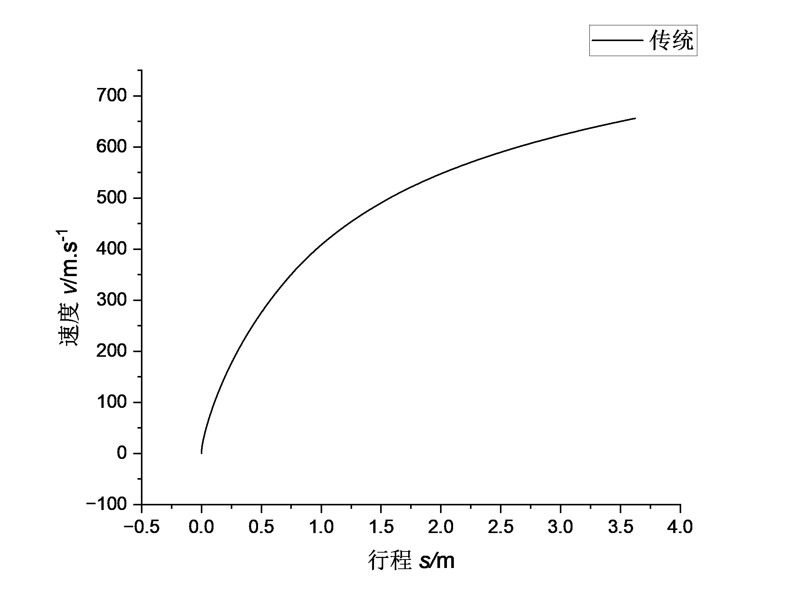 |

| 压力—时间 | 速度—时间 |
| :---: | :---: |
| 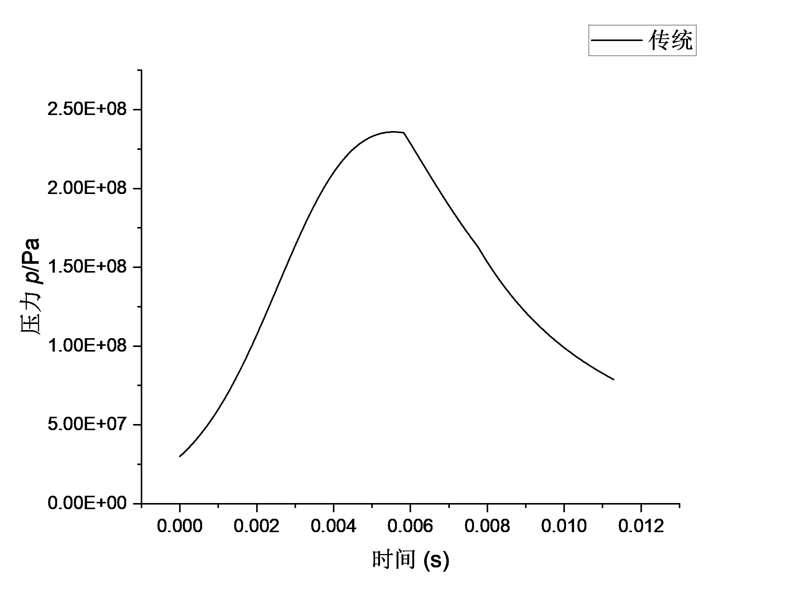 | 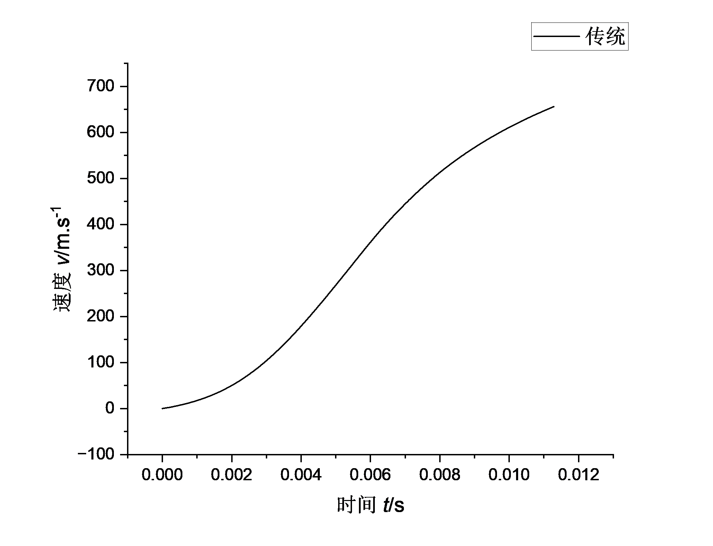 |

### 2.5 优化解与优化结果（论文表 4.12、4.13）

| 优化解参数 | 值 |
| :--- | ---: |
| 装药利用系数 $\eta_\omega$ | 1419.3080 kJ/kg |
| 火药弧厚 $e_1$ | 0.5433 mm |

| 计算结果 | 值 |
| :--- | ---: |
| 行程长 $l_g$ | 35.1823 dm |
| 炮口压力 $p_g$ | 80.0024 MPa |
| 炮口初速 $v_g$ | 655.6608 m/s |
| 最大膛压 $p_m$ | 230.8405 MPa |

| Pareto 前沿 | Pareto 最优解集 |
| :---: | :---: |
|  |  |

| 压力—行程 | 速度—行程 |
| :---: | :---: |
|  | 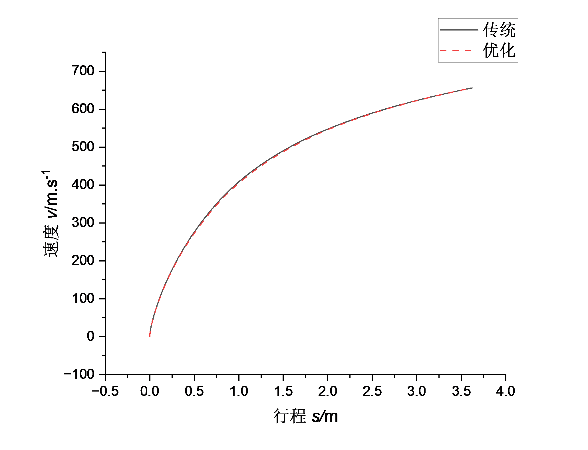 |

| 压力—时间 | 速度—时间 |
| :---: | :---: |
| 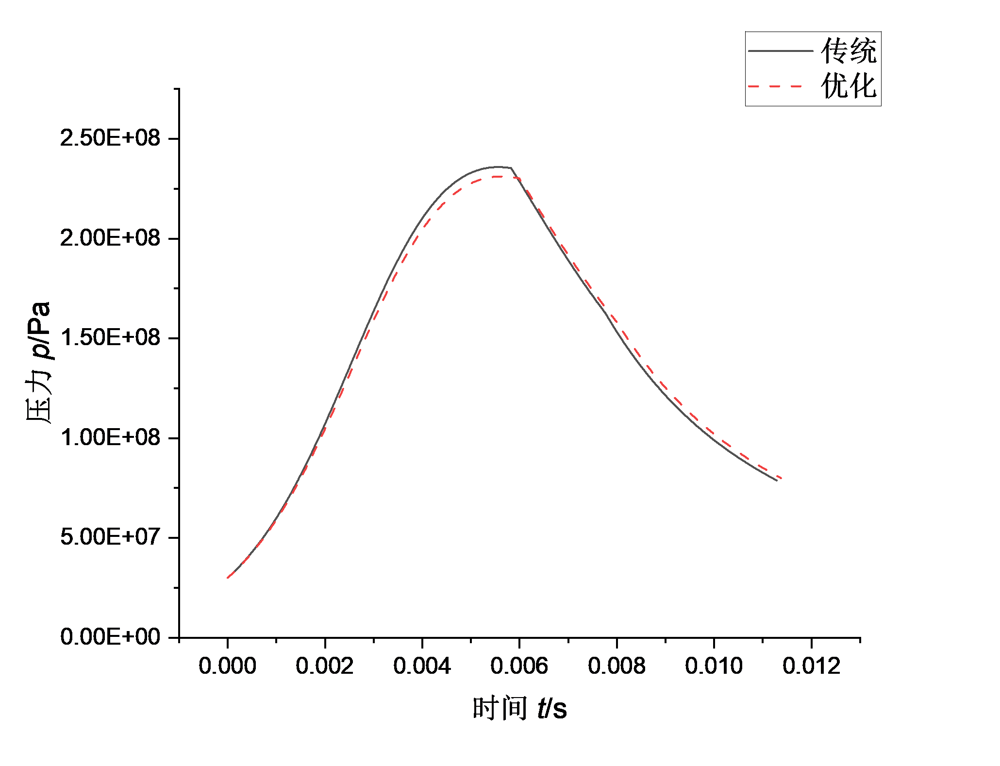 | 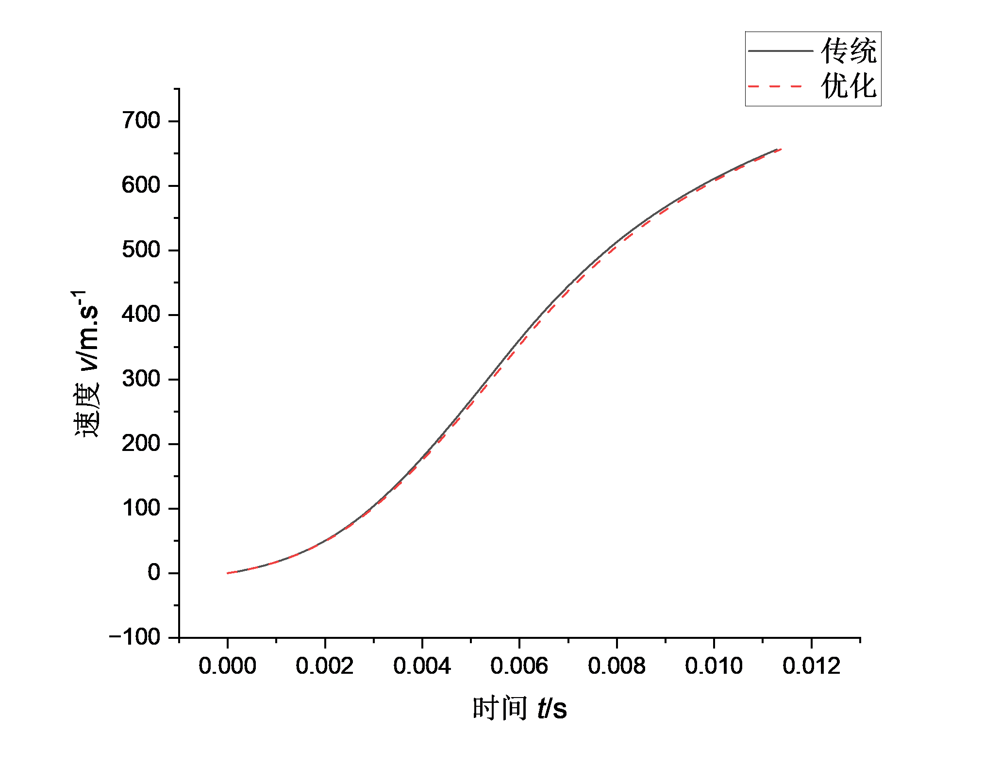 |

### 2.6 优化前后对比（论文表 4.14）

| 指标 | 传统设计 | 优化设计 | 变化范围 |
| :--- | ---: | ---: | ---: |
| 装药利用系数 $\eta_\omega$ | 1500 kJ/kg | 1419.3080 kJ/kg | −5.38 % |
| 火药弧厚 $e_1$ | 0.5208 mm | 0.5433 mm | +4.32 % |
| 行程长 $l_g$ | 36.2278 dm | 35.1823 dm | −2.88 % |
| 炮口压力 $p_g$ | 78.8305 MPa | 80.0024 MPa | +1.49 % |
| 炮口初速 $v_g$ | 656.0344 m/s | 655.6608 m/s | −0.06 % |
| **最大膛压 $p_m$** | **235.8341 MPa** | **230.8405 MPa** | **−2.12 %** |

---

## 3. 代码中的实际参数取值

下表是 `src/ballistic_design.m`（152 mm 案例）与
`legacy/04-57mm-parameter-variant/ballistic_design.m`（57 mm 案例）中的字面量，
便于对照复现。

| 参数 | 152 mm 案例（`src/`） | 57 mm 案例（`legacy/04`） |
| :--- | ---: | ---: |
| `diameter` | 152e-3 m | 57e-3 m |
| `m` | 44.2 kg | 2.8 kg |
| `v_g` | 650 m/s | 1000 m/s |
| `P_mT` | 220（MPa） | 303（MPa） |
| `chi_k` | 1.19 | 1.9 |
| `delta` | 0.55e3 kg/m³ | 0.79e3 kg/m³ |
| `lambda_g` | 7 | 6.4 |
| `phi1` | 1.03 | 1.03 |
| `n`（孔数） | 7 | 7 |
| `f` | 931000 J/kg | 950000 J/kg |
| `k` | 1.2 | 1.2 |
| `alpha` | 0.001 m³/kg | 0.001 m³/kg |
| `rho_p` | 1600 kg/m³ | 1600 kg/m³ |
| `u1` | 4.558e-9 | 1.8e-8 |
| `n1` | 0.89 | 0.829 |
| `c`（药粒半长） | 14.5e-3/2 m | 14.5/2 ⚠ 见下 |
| `eta_s` | 0.82 | 0.82 |
| `p0` | 3e7 Pa | 3e7 Pa |
| 二分法固定 $\eta$ | 1500 | 1500 |

> ⚠ **57 mm 版本的 `c` 存在量纲问题**：该文件写作 `params.c = 14.5/2`（= 7.25），
> 而 152 mm 最终版为 `14.5e-3/2`（= 7.25e-3 m）。`c` 应与 `e1`、`D0`、`d0`
> 同为单位米，否则 `beta = e1/c` 与形状特征量 $\chi,\lambda,\mu$ 会显著失真。
> 该历史文件按原样归档未作修改，复现 57 mm 案例前请先核对。

---

## 4. 数据一致性提示

整理过程中对论文表格做了算术校核，有以下两点建议核对（**不影响代码逻辑**）：

1. **表 4.10（57 mm）装药利用系数变化率**：表中列出 1176 → 1148.8894 kJ/kg 与
   "−3.54 %"。按表中数值直接计算为 $\dfrac{1148.8894-1176}{1176} = -2.31\%$
   （绝对变化 −27.11 kJ/kg）。同表其余 5 项（+2.50 %、+1.40 %、+2.76 %、
   +0.09 %、−2.12 %）与表中数值一致；表 4.14（152 mm）的 −5.38 % 亦与
   $1419.3080 \to 1500$ 的计算结果一致。此处疑似排版笔误，建议核对原始数据。
2. **第 3 章小结与第 5 章结论的膛压数字**：3.5 节小结写作"膛压峰值降低 2.12 %
   （306.3 MPa→300.1 MPa）"，而 306.3 → 300.1 实为 −2.02 %；第 5 章结论与
   表 4.10 一致，为 **312.9 → 306.3 MPa（−2.12 %）**。建议以表 4.10 为准。

以上仅涉及论文中的文字与表格表述，代码与曲线图未受影响。
